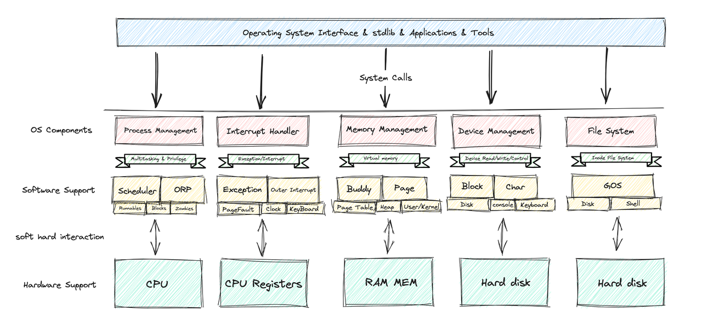

# GOS：x86 32 位教学操作系统

GOS 使用 C 与 NASM 实现一个可在 QEMU 中运行的操作系统内核，能够烧写到80386 的板子上运行。

项目重点是把操作系统原理落实到可阅读、可调试的代码：从中断现场和页表项，到进程切换、目录项更新与文件数据块回收，均提供对应实现。适合用于操作系统课程实践、底层开发学习，以及系统软件方向的项目展示。

**技术栈：** C、NASM、x86 保护模式、GDT / IDT / TSS、两级分页、Buddy、IDE PIO、Inode 文件系统、QEMU、GDB 调试接口、交叉编译。

## GOS架构图


## 已实现能力

| 模块 | 核心实现 | 源码入口 |
| --- | --- | --- |
| 引导与初始化 | BIOS 两阶段引导、E820 内存探测、开启 A20、进入 32 位保护模式、加载并初始化内核 | [boot.asm](src/bootloader/boot.asm)、[loader.asm](src/bootloader/loader.asm)、[kernel_main.c](src/kernel/kernel_main.c) |
| 内存管理 | 4 KiB 物理页及连续页分配、固定堆上的 Buddy 分裂与合并、两级页表、缺页触发的基础映射、CR3 切换与 TLB 刷新 | [frame.c](src/kernel/memory/frame.c)、[buddy.c](src/kernel/memory/buddy.c)、[memory_mapping.c](src/kernel/memory/memory_mapping.c)、[page.c](src/kernel/int/page.c) |
| 中断与异常 | IDT、8259A PIC、异常公共入口、PIT 时钟、键盘输入、缺页异常处理 | [int/](src/kernel/int/) |
| 进程与调度 | PCB、PID 分配、环形就绪队列、约 100 Hz 时钟驱动的轮转调度、上下文切换、`fork / exit / waitpid / yield` | [process.c](src/kernel/process/process.c)、[create.c](src/kernel/process/create.c)、[switch.asm](src/kernel/process/switch.asm) |
| 用户态与系统调用 | 用户代码/数据段、TSS 内核栈切换、`iret` 进入 Ring3、`int 0x80` 调用及返回 | [gdt.c](src/kernel/gdt/gdt.c)、[trap_handler.asm](src/kernel/int/trap_handler.asm)、[int/syscall.c](src/kernel/int/syscall.c) |
| 磁盘与设备 | 设备表、读写回调、IDE 设备识别、同步 PIO 扇区读写 | [device.c](src/kernel/device/device.c)、[disk.c](src/kernel/disk/disk.c) |
| GFS 文件系统 | 超级块、inode / 数据块位图、固定 inode 布局、目录与路径解析、owner 权限、文件读写及递归文件操作 | [fs.c](src/kernel/fs/fs.c)、[fs/type.h](src/kernel/fs/type.h) |
| GShell 与控制台 | VGA 文本输出、清屏与滚屏、键盘缓冲、命令解析、12 个内置命令 | [gshell.c](src/user/gshell.c)、[console.c](src/kernel/console/console.c) |
| 基础设施 | 格式化输出、日志与断言、哈希表、循环队列、结合调度器的可重入锁 | [lib/](src/kernel/lib/)、[ds/](src/kernel/ds/) |

系统调用采用自定义 ABI：`EAX` 传递调用号，`EBX / ECX / EDX` 传递参数，`EAX` 返回结果。实际入口包括进程生命周期、时间与输入输出、目录切换及文件操作，完整定义见 [int/type.h](src/kernel/int/type.h)。

## 关键实现与工程取舍

### 1. 从启动到用户态的完整链路

Bootloader 获取内存布局并进入保护模式，内核依次初始化内存、中断、进程、分页、设备和文件系统，再创建用户进程进入 GShell。用户进程通过 GDT 中的 DPL3 段、TSS 和返回现场进入 Ring3；调用内核功能时，通过 `int 0x80` 进入统一分发入口。

以文件复制为例，可以沿下面的调用链阅读代码：

```text
GShell 参数解析
  → CopyFilePath 用户态封装
  → int 0x80 / TrapHandler
  → CopyPath / GFS 路径与权限检查
  → 目录项、inode 和数据块操作
  → 设备回调 / IDE PIO
```

这条链路适合结合断点讲解调用约定、寄存器传参、内核栈和持久化数据的变化。

### 2. 分层内存管理

物理页分配器根据 E820 信息维护页帧状态，向上提供单页及连续页分配；Buddy 在预留的连续内存上实现内核堆分配，通过块分裂满足请求，并在释放时尝试合并。当前堆大小为 16 个页面，即 64 KiB。

虚拟内存采用 4 KiB 页面和两级页表。进程切换时按需更新 CR3；缺页处理调用映射接口补充页表及数据页。这里实现的是基础缺页分配机制，VMA 管理、权限故障分类和页面置换属于后续扩展。

### 3. 进程切换与生命周期

调度器使用环形就绪队列，PIT 时钟约每 10 ms 触发一次调度，也支持进程主动 `Yield`。切换过程保存和恢复寄存器现场，必要时切换页表，并为用户进程更新 TSS 的 `ESP0`。

`fork` 复制内核栈、用户页表和已存在的数据页，子进程返回值为 0，父进程获得子 PID。当前采用立即复制（eager copy），共享低地址映射；COW 是后续可讨论的优化方向。`exit` 记录退出码并进入僵尸状态，`waitpid` 完成子进程状态查询与 PCB 回收；用户库在子进程尚未退出时通过 `Yield` 后重试。

### 4. 文件系统格式、路径与权限

GFS 使用 512 字节块、128 字节 inode 和 32 字节目录项，通过位图管理 inode 与数据块。当前实际使用 27 个直接块；结构中的一级、二级间接索引字段仍为预留。静态断言检查 inode 大小及直接块字段偏移，便于保持磁盘布局兼容。


## 简历项目描述参考

**项目名称：GOS——x86 32 位操作系统内核**

**技术栈：C / NASM / x86 / QEMU / GDB / macOS 交叉编译**

参考Linux，实现了一个基于80386体系结构的操作系统宏内核架构项目，其实现了：内存管理（堆管理、页式虚拟存储系统）、进程管理、中断/异常/系统调用、磁盘IO、文件系统、shell终端。
1. 内存管理：实现了伙伴系统Buddy；页式虚拟存储系统二级页表。
2. 进程管理：实现了进程调度与管理（RR、FIFO、Priority、高响应比优先调度算法）；用户级进程；
3. 中断：外中断，实现了时钟中断、键盘中断、磁盘中断；
4. 异常：实现了缺页异常、除零异常、保护异常等20个异常处理。
5. 系统调用：实现了SYSCALL_GET_TIME，SYSCALL_READ，SYSCALL_WRITE，SYSCALL_GET_PID，SYSCALL_GET_PPID，SYSCALL_YIELD，SYSCALL_EXIT，SYSCALL_WAIT_PID，SYSCALL_TASK_INFO，SYSCALL_MMAP，SYSCALL_MUNMAP，SYSCALL_SLEEP等诸多系统调用。重点是MMAP、MUNMAP、FORK、EXIT、WAITPID等。
6. 磁盘IO：实现了PIO（可编程输入输出） 读写磁盘；设备管理器的实现；
7. 文件系统：实现了一个Inode文件系统，采用27个直接索引、1个一级索引、1个二级索引。并提供了PrintfWorkingDirectory、ChangeDirectory、ListFiles、MakeDirectory、CreateFile、ClearFileContent、ReadFileLine、WriteFileContent、PrintFileContent、RemoveFile、GetFileDescriptorByFileName等诸多文件操作。
8. shell终端：实现一个shell终端（自己起名），内置了cat、ls、cd、mkdir、pwd、echo、vim、touch、rm、ps等常用的类Linux命令。
9. 实现了操作系统级别的C语言泛型数据结构：锁、循环队列、哈希表等

### 调试入口

```sh
make debug-mac
```

## GShell 使用与演示

默认工作目录为 `/`，主目录为 `/home/JackHu`。命令行支持重复空白、单双引号和退格，最多 511 字节、16 个参数。以下为当前实现的命令范围：

| 命令 | 支持行为 |
| --- | --- |
| `pwd` | 输出完整工作路径 |
| `cd [path]` | 相对 / 绝对路径、`.`、`..`、`~`；无参数回主目录 |
| `mkdir [-p] path ...` | 创建目录；`-p` 创建缺失父目录 |
| `ls [-a] [path]` | 列出文件和子目录；目录蓝色并带 `/`；`-a` 包含隐藏项 |
| `touch filename` | 在当前目录创建一个新文件 |
| `echo text > filename` | 覆盖已存在文件；正文可用引号包含空格 |
| `cat path` | 显示一个文本文件的内容 |
| `rm [-rRfidv] [--] path ...` | 删除文件 / 目录；递归、强制、交互确认、空目录删除及结果输出 |
| `cp [-rRfinvT] [--] source ... target` | 文件 / 目录复制；递归、覆盖控制、交互确认及多源复制 |
| `mv [-finvT] [--] source ... target` | 文件 / 目录移动与重命名，支持覆盖控制及多源操作 |
| `clear` | 清空 VGA 文本及滚屏区域，提示符回到左上角 |
| `whoami` | 显示固定的 `root` 标识 |

`rm / cp / mv` 中，`-i` 表示确认，`-f` 表示强制策略，`-n` 表示保留已有目标（仅 `cp / mv`），`-v` 输出操作结果；冲突的覆盖策略以后出现的选项为准。`-T` 将复制 / 移动目标作为指定路径，多源操作要求最后一个参数为已存在目录。

### 文件操作演示

下面依次演示目录创建、文本读写、文件与目录复制、重命名及清理。`demo` 使用一个尚未占用的测试目录名：

```sh
cd ~
mkdir demo
cd demo
mkdir -p docs/sub
touch note.txt
echo "hello gos" > note.txt
cat note.txt
cp note.txt docs/copied.txt
mv docs/copied.txt docs/moved.txt
cd docs
ls
cat moved.txt
cd ..
cp -r docs backup
cat backup/moved.txt
mv backup archived
ls
rm note.txt
rm -r docs archived
ls
cd ..
rm -r demo
```

其中三次 `cat` 应输出 `hello gos`；目录应显示为蓝色。清理后测试目录中 `ls` 应为空。也可以在清理前尝试 `cd missing`、`mkdir docs` 或 `rm docs`，观察路径不存在、目录已存在和非递归删除目录的错误提示。

## 分支与实验资料

`master` 用于集成展示；`feature/ch*` 保存分阶段实现；`lab*` 与对应的 `-done` 分支用于实验和参考实现。下面集中保留阶段说明和实验资料，具体能力以各分支源码为准。

| 分支 | 阶段内容 |
| --- | --- |
| `master` | 当前集成版本 |
| `feature/ch0` | Bootloader 与保护模式入口 |
| `feature/ch1` | 控制台输出 |
| `feature/ch2` | 输出扩展与基础内存管理 |
| `feature/ch3` | 中断、异常与系统调用 |
| `feature/ch4` | 进程管理与调度 |
| `feature/ch5` | 用户态与内核态 |
| `feature/ch6` | 两级页表与分页 |
| `feature/ch7` | fork 与父子进程 |
| `feature/ch8` | 系统调用扩展 |
| `feature/ch9` | 磁盘识别与读写 |
| `feature/ch10` | GFS Inode 文件系统 |
| `feature/ch11` | GShell 终端 |

| 实验分支 | 主题 |
| --- | --- | 
| `lab0` / `lab0-done` | 中间代码加载与执行 |
| `lab1` / `lab1-done` | 日志模块与固定分区分配 |
| `lab2` / `lab2-done` | 中断与系统调用 |
| `lab3` / `lab3-done` | FCFS 调度问题分析与调度实现 |
| `lab4` / `lab4-done` | 系统调用 printf |
| `lab5` / `lab5-done` | 缺页异常处理 |
| `lab6` / `lab6-done` | 系统调用扩展 |
| `lab7` / `lab7-done` | 经典 Shell 命令 |